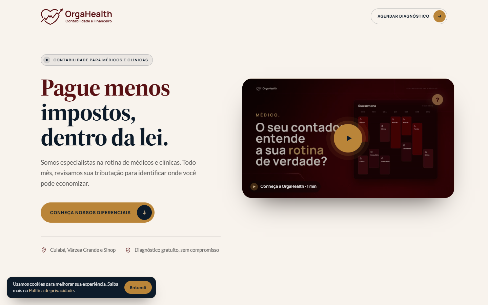
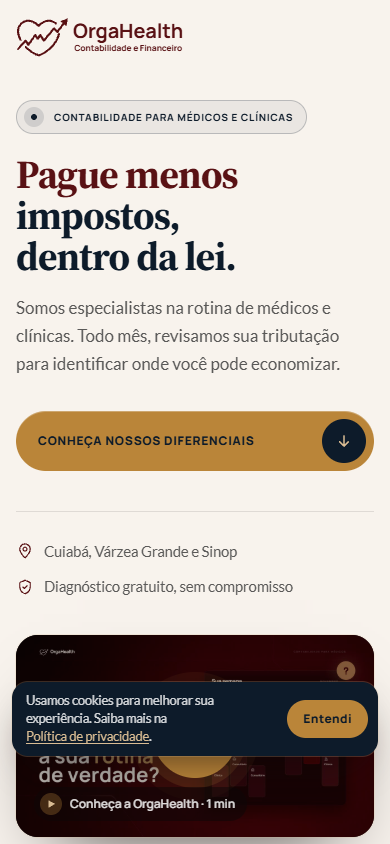

<div align="center">

# OrgaHealth · Landing Page de Diagnóstico Financeiro

**Landing page de captação de leads para contabilidade médica especializada**
Cuiabá · Várzea Grande · Sinop (MT)


### [Ver demonstração ao vivo →](https://otaviofer.github.io/LP_orga_health/)

</div>

<p align="center">
  
  &nbsp;
  
</p>

---

## Sobre o projeto

A **OrgaHealth** é uma assessoria contábil e financeira 100% focada em médicos e clínicas. Esta landing page leva o médico até o agendamento de um **diagnóstico financeiro personalizado**, com uma proposta clara: reduzir impostos e organizar as finanças com contabilidade médica especializada.

A página foi desenhada a partir do briefing do cliente, com a copy aprovada, e seguindo o **Manual de Marca OrgaHealth** (paleta oficial, tipografia e logos em SVG).

| | |
|---|---|
| **Cliente** | OrgaHealth — Contabilidade e Financeiro |
| **Agência** | V4 Borges & Co |
| **Objetivo** | Geração de leads (formulário) para diagnóstico financeiro |
| **Público** | Médicos plantonistas, recém-formados e donos de clínicas/consultórios |
| **Plataforma de publicação** | GreatPages |

## Estrutura da página

1. **Hero** — título, subtítulo, CTA principal e vídeo institucional dos sócios
2. **Contabilidade 100% focada** — foto da equipe médica com entrada animada e degradê
3. **Diferenciais** — 4 pilares com destaque marsala no hover (toque no mobile) e botão "Contratar" que leva ao formulário
4. **Depoimentos** — citação em destaque com seletor, setas, teclado e swipe
5. **Dúvidas frequentes** — objeções em formato de conversa (pergunta → resposta)
6. **Formulário** — Nome, Sobrenome, WhatsApp, E-mail e "Eu sou", com validação inline
7. **Presença física** — foto da sede e mapa do Google clicável
8. **Rodapé** — contatos, redes, links legais e crédito da V4 Borges & Co

Elementos fixos: header flutuante que aparece após o hero e botão **voltar ao topo**. Todos os CTAs levam ao formulário, que é a conversão da página; o WhatsApp aparece só no rodapé.

## Identidade visual

| Cor | HEX | Uso |
|---|---|---|
| Marsala | `#591114` | Cor principal: hero, destaques, rodapé |
| Azul-marinho | `#0D1B2A` | Títulos, formulário, balões do FAQ |
| Dourado | `#BA8539` | CTAs e acentos |
| Creme | `#F8F3ED` | Fundo das seções claras |
| Grafite | `#262626` | Texto corrido |

**Tipografia:** [Source Serif 4](https://fonts.google.com/specimen/Source+Serif+4) (títulos, auto-hospedada em `assets/fonts/`, licença OFL), [Manrope](https://fonts.google.com/specimen/Manrope) (labels e botões) e [Lato](https://fonts.google.com/specimen/Lato) (texto corrido).

## Ferramentas e tecnologias

| Categoria | Ferramenta |
|---|---|
| Código | HTML5 semântico, CSS3 (custom properties, Grid, Flexbox, `clamp()`) e JavaScript puro (sem dependências) |
| Interações | IntersectionObserver (entradas em cascata), Pointer Events (swipe), CSS transitions com curvas `ease-out` |
| Design | Figma (design system com variáveis e componentes) e FigCraft (arquivo `.figcraft`) |
| Imagens | Logos oficiais em SVG do cliente; foto da equipe gerada por IA (ElevenLabs Creative + remoção de fundo BiRefNet) |
| Mapa | Google Maps embed |
| Testes | Puppeteer + Chrome headless (renderização em 390, 820 e 1440 px, checagem de overflow e de estados de erro) |
| Desenvolvimento | Claude Code, VS Code e Git |

## Qualidade

- **Responsivo** de 360 px a 1440 px+, sem rolagem horizontal
- **Acessibilidade:** link "pular para o conteúdo", foco visível, `aria-expanded` no FAQ, `aria-live` nos depoimentos, erros de formulário ligados por `aria-describedby`
- **Movimento:** respeita `prefers-reduced-motion` e `prefers-reduced-transparency`
- **Performance:** animações só com `transform`/`opacity`, imagens com `loading="lazy"`, sem bibliotecas externas
- **Formulário:** máscara de WhatsApp, validação de e-mail e mensagens de erro inline

## Estrutura do repositório

```
LP_orga_health/
├── index.html                 # Landing page (versão 2, atual)
├── assets/
│   └── img/
│       ├── equipe-medica.png  # Foto da equipe (PNG recortado)
│       └── logo-v4-borges-branca.webp
├── design/
│   ├── orga-health-lp.figcraft  # Layout editável no FigCraft (desktop + mobile)
│   └── orga-health-lp.svg       # Mesmo layout em SVG
├── docs/
│   ├── preview-desktop.png
│   └── preview-mobile.png
└── versions/
    └── v1.html                # Primeira versão (referência)
```

## Como rodar localmente

Não há build: basta servir a pasta.

```bash
npx http-server . -p 5173
```

Depois acesse `http://localhost:5173`. O mapa do Google só carrega quando a página é servida por HTTP(S), não ao abrir o arquivo direto do disco.

## Pendências antes de publicar

- [ ] Vídeo institucional dos sócios (hero)
- [ ] Foto da fachada/ambiente da sede em Várzea Grande
- [ ] Depoimentos reais (nomes, especialidades e textos marcados com `[confirmar]`)
- [ ] Endereço completo no rodapé
- [ ] Integração do formulário com o GreatPages e página de obrigado
- [ ] Links de Política de privacidade e Termos de uso

---

<div align="center">

Desenvolvido por **V4 Borges & Co** para **OrgaHealth** · 2026
Projeto proprietário — todos os direitos reservados.

</div>
